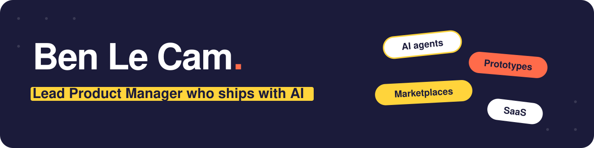

### Hi, I'm Ben

Lead Product Manager, 8+ years across SaaS, AI, robotics and marketplaces. I prototype with AI, put it in front of customers, and hand engineering a spec that has already been tested by the people who will use it.

This page is the hands on side of my work: things I've built, wired to real APIs, running in production.

### Results I've shipped

| | |
| --- | --- |
| **8% → 90%+** | User engagement on Cargomatic's freight marketplace, as Group PM |
| **0 → 2,500** | Daily visitors on FanDuel's corporate site, built from scratch in under 3 months |
| **80% fewer** | Support tickets after I deployed an LLM support chatbot |
| **0 → 1,000** | Transactions on ViewShaper, the marketplace I co-founded, in under 6 months |

### What I build with AI

**[AI booking agent](https://github.com/bounceLC/ai-booking-agent).** The assistant on my site: answers questions about my background and books calls on my real calendar, inside the chat. Claude tool use, Cal.com, Cloudflare. Open source, try it on [benjaminlecam.info](https://benjaminlecam.info).

**[Feedback triage agent](https://github.com/bounceLC/feedback-triage-agent).** Pulls customer and stakeholder requests from Intercom and Slack every week, scores them against the team's prioritization rules, and sends a ranked list. Replaced hours of triage meetings. The model tags, your rules rank, so every position is defensible. Open source with a demo you can run in 10 seconds.

**Stale deal agent.** Watches the CRM and emails the rep when a deal hasn't moved in two weeks.

**Client tested prototypes.** Working website prototypes built with AI, competing versions tested with real clients. The winner becomes the spec.

### How I work

Start with the real problem, not the loudest request. Decide with data: funnels, A/B tests, SQL. Prototypes are for learning; anything customers rely on, engineering owns. Ship small, measure before celebrating.

### Tools I actually use

Claude Code · Anthropic API · Cloudflare Pages · Cal.com API · GitHub · SQL · Amplitude · Mixpanel · Figma · Jira

### Let's talk

[benjaminlecam.info](https://benjaminlecam.info) · [LinkedIn](https://www.linkedin.com/in/benjaminlecam/) · [Book a 30 min intro](https://cal.com/benjamin-le-cam/30min)
